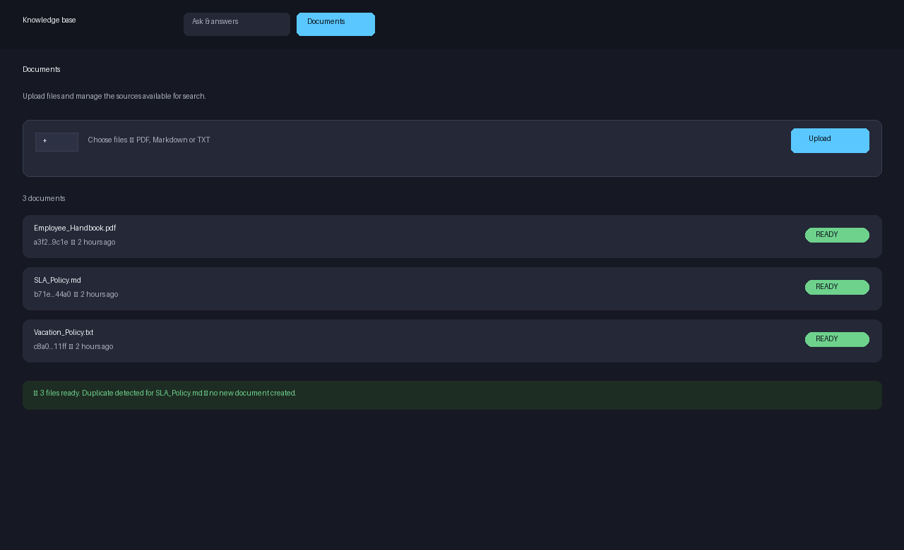
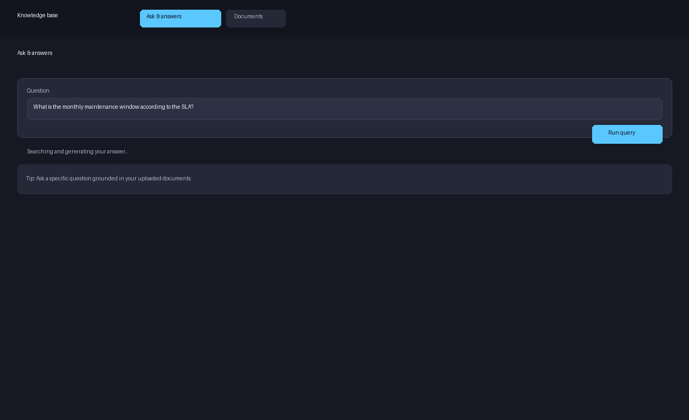
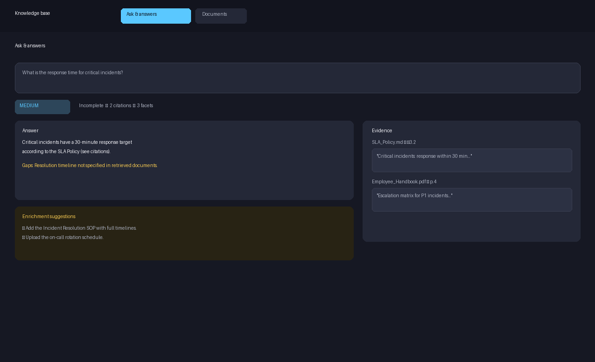

# Knowledge Base Search & Enrichment

Local, AI-powered document search and answer generation with enrichment suggestions.

## Overview

This system allows users to:

- Upload multiple documents (PDF, Markdown, TXT)
- Search documents using natural language questions
- Receive AI-generated answers grounded in the retrieved document content
- Identify when information is missing or uncertain
- Get suggestions for enriching the knowledge base

All AI processing runs locally via Ollama. No external AI provider or API key is used.

## Technology Stack

- **Backend:** Python 3.14, FastAPI, Pydantic v2
- **Embeddings:** Ollama `nomic-embed-text` (768 dimensions)
- **Generation:** Ollama `qwen2.5:3b`
- **Vector store:** Qdrant (cosine distance, 768 dimensions)
- **PDF processing:** PyMuPDF
- **Runtime:** Docker Compose

## Architecture Decisions

- **Local-only AI:** No external AI APIs, no API keys, no fallback providers.
- **No authentication or CORS:** Single-user local prototype.
- **Environment-based configuration:** Settings loaded from environment variables.
- **Structured JSON output:** `answer`, `confidence`, `is_complete`, `missing_info`, `citations`, `facets`.
- **Text-based PDFs only:** OCR is out of scope.
- **No cloud deployment:** Local prototype only.

## Supported Document Types

- PDF (text-based, no OCR)
- Markdown (.md)
- Plain text (.txt)

## Out of Scope

- OCR for image-based PDFs
- Auto-enrichment from external sources
- Hybrid search or reranking
- Authentication and authorization
- Cloud deployment
- Answer quality rating

## Project Structure

```
wand-take-home/
├── backend/                # Backend API and services
│   ├── app/               # FastAPI application
│   │   ├── api/          # FastAPI routers
│   │   ├── schemas/      # Pydantic models
│   │   ├── services/     # Business logic
│   │   ├── config.py     # Configuration
│   │   └── main.py       # FastAPI application entry point
│   ├── tests/            # Backend tests
│   ├── docs/             # Data-contract integrity rules
│   ├── pyproject.toml    # Project configuration
│   └── uv.lock           # Dependency lock file
├── eval/                  # Evaluation dataset and runner
│   ├── documents/        # Sample documents
│   ├── cases.json        # Evaluation cases
│   ├── run_eval.py       # Evaluation runner
│   ├── CALIBRATION.md    # Threshold calibration notes
│   └── RESULTS.md        # Observed evaluation results
├── docker-compose.yml    # Compose stack
└── README.md             # This file
```

## Configuration

All configuration is via environment variables (loaded by `backend/app/config.py`):

| Variable | Default | Description |
|----------|---------|-------------|
| `OLLAMA_BASE_URL` | `http://ollama:11434` | Ollama API URL |
| `OLLAMA_EMBEDDING_MODEL` | `nomic-embed-text` | Embedding model |
| `OLLAMA_GENERATION_MODEL` | `qwen2.5:3b` | Generation model |
| `QDRANT_HOST` | `qdrant` | Qdrant host |
| `QDRANT_PORT` | `6333` | Qdrant port |
| `QDRANT_COLLECTION_NAME` | `knowledge_base` | Vector collection name |
| `EMBEDDING_DIMENSIONS` | `768` | Must match `nomic-embed-text` |
| `CHUNK_SIZE` | `1000` | Chunk size in words |
| `CHUNK_OVERLAP` | `200` | Chunk overlap in words |
| `UPLOAD_DIR` | `data/uploads` | Document storage |
| `REGISTRY_PATH` | `data/registry.json` | Document registry JSON file |
| `RETRIEVAL_TOP_K` | `5` | Number of chunks retrieved |
| `RETRIEVAL_THRESHOLD` | `0.55` | Minimum cosine similarity to pass the gate |
| `MAX_CONTEXT_TOKENS` | `2048` | Estimated token budget for generation context |

## Running the Application

```bash
docker compose up -d --build
```

The `--build` flag builds the backend image, including the frontend bundle (see ADR 0019) — no host-side `npm` step is needed on a fresh clone.

This starts:

- `app` on http://127.0.0.1:8000
- `qdrant` on http://127.0.0.1:6333
- `ollama` on http://127.0.0.1:11434
- `ollama-init` pulls `nomic-embed-text` and `qwen2.5:3b` once into a persistent volume

API documentation is available at http://127.0.0.1:8000/docs (Swagger) and http://127.0.0.1:8000/openapi.json (raw OpenAPI). The frontend is served from the same origin at http://127.0.0.1:8000/ — no separate frontend port is needed.

## Trying the API

All endpoints are available at `http://127.0.0.1:8000`. Interactive docs: [http://127.0.0.1:8000/docs](http://127.0.0.1:8000/docs).

### Health check

```bash
curl http://127.0.0.1:8000/api/health
# {"status":"ok"}
```

### List documents

```bash
curl http://127.0.0.1:8000/api/documents
```

### Upload documents

```bash
# Single file
curl -X POST http://127.0.0.1:8000/api/documents \
  -F "files=@eval/documents/SLA_Policy.md"

# Multiple files
curl -X POST http://127.0.0.1:8000/api/documents \
  -F "files=@eval/documents/SLA_Policy.md" \
  -F "files=@eval/documents/Employee_Handbook.pdf"
```

Response includes per-file statuses (`READY`, `PROCESSING`, `FAILED`, `DUPLICATE`, `REJECTED`) and a `document_id` for each accepted file. Duplicate content (same SHA-256) returns `DUPLICATE` without creating a new document.

### Query (RAG answer)

```bash
curl -X POST http://127.0.0.1:8000/api/query \
  -H "Content-Type: application/json" \
  -d '{"question": "What is the response time for critical incidents?"}'
```

Response shape:

```json
{
  "answer": "…",
  "confidence": "HIGH | MEDIUM | LOW | INSUFFICIENT_DATA",
  "is_complete": true,
  "missing_info": [],
  "citations": [...],
  "facets": [...]
}
```

If no chunk passes `RETRIEVAL_THRESHOLD` (0.55), the API returns `confidence: "INSUFFICIENT_DATA"` without calling the LLM.

### Search (raw retrieval, no generation)

```bash
curl -X POST http://127.0.0.1:8000/api/search \
  -H "Content-Type: application/json" \
  -d '{"query": "maintenance window", "top_k": 5}'
```

### Delete a document

```bash
curl -X DELETE http://127.0.0.1:8000/api/documents/{document_id}
```

## Using the Frontend

The frontend is a single-page app with two views: **Documents** and **Ask & answers**. It is built into the backend image, so `docker compose up -d --build` is enough — then open [http://127.0.0.1:8000/](http://127.0.0.1:8000/).

### 1. Upload documents

Open **Documents** → **Choose files** → **Upload**. Supported types: PDF (text-based), Markdown, TXT.



After upload you will see a summary (e.g. “3 files ready”) and each row shows its SHA-256 prefix, age, and status badge (`READY`, `PROCESSING`, `FAILED`, `DUPLICATE`). Use the refresh button if a file is still processing.

### 2. Ask a question

Switch to **Ask & answers**. Type a question grounded in your documents and click **Run query**.



If no documents are ready, the view shows a prompt to upload first.

### 3. Read the answer

The result shows:

- **Confidence** and **Completeness** badges (`HIGH`/`MEDIUM`/`LOW`/`INSUFFICIENT_DATA`, `Complete`/`Incomplete`)
- **Answer** text grounded in citations
- **Gaps / Missing info** when `is_complete` is `false`
- **Enrichment suggestions** — actionable next documents or data to upload
- **Evidence** panel with document name, section, and excerpt for each citation



Tip: start with a specific question (e.g. “What is the monthly maintenance window?”) rather than a meta question like “Are there any conflicts?” — the latter may gate out under dense retrieval (see Known Limitations).

## Retrieval and Thresholding

Retrieval uses dense vector search in Qdrant with cosine similarity. The pipeline:

1. Embed the question with `nomic-embed-text`.
2. Retrieve `RETRIEVAL_TOP_K` chunks.
3. Deduplicate identical fragment texts, keeping the highest score.
4. Apply `MAX_CONTEXT_TOKENS` budget.
5. Gate: only chunks with cosine similarity >= `RETRIEVAL_THRESHOLD` are passed to generation.
6. If no chunk passes the threshold, generation is skipped and a structured `INSUFFICIENT_DATA` response is returned.

The chosen threshold and observed false rejections/acceptances are documented in `eval/CALIBRATION.md`.

## Confidence Rubric

- **HIGH:** The answer is directly and unambiguously supported by the retrieved evidence.
- **MEDIUM:** The evidence supports the answer but a material facet remains partially covered or ambiguous.
- **LOW:** The evidence is weak, tangential, or the answer is uncertain.
- **INSUFFICIENT_DATA:** No fragment passed the relevance threshold; generation was not invoked.

There is no `confidence_score`; confidence is qualitative only.

## Completeness Semantics

- `is_complete=True` only when all material facets are answered and no material gaps or conflicts remain. `missing_info` must be empty and no facet may be `MISSING`, `UNCERTAIN`, or `CONFLICTING`.
- `is_complete=False` when evidence is partial, ambiguous, conflicting, or missing.
- `INSUFFICIENT_DATA` confidence always implies `is_complete=False`.

## Known Limitations

- **Local model latency:** First generation call can be slow while the model loads into memory; subsequent calls are faster.
- **Structured-output quality:** `qwen2.5:3b` sometimes returns malformed JSON or violates the facet/citation contract. The backend applies one bounded retry and returns a controlled `INSUFFICIENT_DATA` error if validation still fails; blank answers are now rejected the same way (Phase 6 fix, verified against a prompt-injection probe).
- **Dense retrieval only:** No hybrid search, reranking, or OCR. Queries that need keyword matching or image-based PDFs will fail.
- **Single-process registry:** The JSON registry is suitable for a single-user prototype; concurrent writers are not supported.
- **Embedding quality:** Small embedding shifts can cause answerable questions to gate out or irrelevant fragments to pass. Calibration is documented in `eval/CALIBRATION.md`.
- **Global/meta questions gate out:** "Are there any conflicts in the documents?" (case_08) returns `INSUFFICIENT_DATA` because dense retrieval does not match this global/meta question strongly enough to pass the 0.55 threshold.
- **Hallucination risk in synthesis (observed):** with `qwen2.5:3b`, a two-document synthesis probe once produced an unsupported clause ("backend work … handled by Alibaba Cloud") with valid-looking citations. Answers are always citation-backed, but individual claims are not semantically fact-checked against the cited excerpts; deterministic claim verification is out of scope.
- **Facet over-acceptance:** the model may mark a facet `ANSWERED` without the answer actually naming the asked fact (observed in case_10: budget approver). Top-level `is_complete` stayed `False`, so the response invariant held.
- **Over-conservative completeness:** fully supported single-fact answers are sometimes marked `is_complete=False` with a `PARTIAL` facet that carries no gap text (observed in case_07/09/13). Conservative, never incomplete→complete.
- **Conflict-pair false positives:** the deterministic conflict detector (ADR 0016) extracts every number in cited excerpts, so an agreeing document can be reported as the conflicting side (case_11 reported "1 vs 2" from "two recovery objectives"). The genuine 1-vs-4 conflict is detected correctly when both sides are cited (case_12).
- **Uncited contradicting evidence ignored:** when the model cites only one side of a known contradiction (case_14: 20 days cited, "ten days" retrieved but uncited), the conflict is not surfaced; the detector inspects only cited excerpts.
- **Conflict-detection scope:** The deterministic backend conflict check (ADR 0016) handles the numeric-contradiction class for the same facet's cited excerpts (e.g., "1 hour" vs "4 hours"). Non-numeric conflicts, semantic equivalences (e.g., "1 hour" vs "60 minutes"), and conflicts excluded from the model's citations remain model-dependent.
- **Event-loop blocking (known issue, fix pending user approval):** the query/search endpoints run blocking Ollama/Qdrant calls on the uvicorn event loop, so one slow query delays other requests at single-worker scale. Brief and plan: `.tasks/2026-10-28-async-blocking-calls/` (awaiting confirmation; not executed in Phase 6).

## Running Tests

Unit tests (no real inference):

```bash
cd backend
rm -rf data/*
uv run pytest -m 'not integration' --tb=short -q
```

Integration tests (require `docker compose up -d`):

```bash
cd backend
uv run pytest -m integration --tb=short -q
```

> **Note:** The unit tests assume a clean `backend/data/` directory. Leftover registry/uploads from previous runs can cause duplicate-detection failures.

## Evaluation

After starting the stack (run from `backend/` so `requests` is available):

```bash
cd backend
uv run python ../eval/run_eval.py
```

Results are written to `eval/RESULTS.md`.

**Phase 6 evaluation results (2026-10-28, real Ollama + Qdrant):** all 14 cases
executed. 9 matched expectations outright; the rest matched behaviorally with
documented nuances. No irrelevant query was accepted as answered and no
answerable question was systematically rejected, so the 0.55 retrieval
threshold was left unchanged. Evidence: `.tasks/2026-10-28-phase6-evaluation/reports/`.

## License

Private repository - Wand AI take-home challenge
